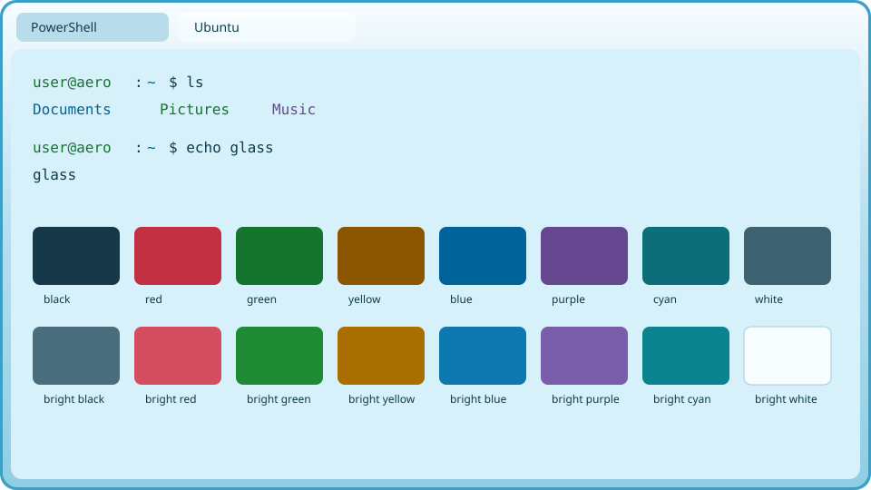
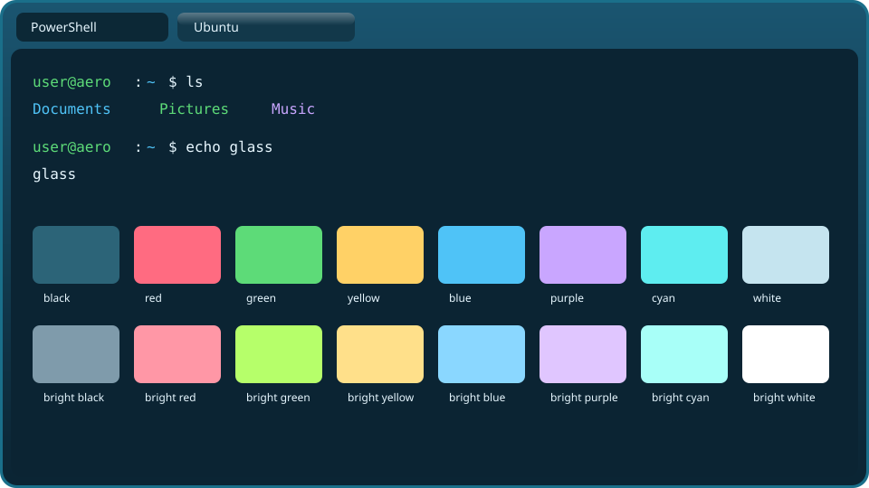

# Frutiger Aero for Windows Terminal

A sky-glass theme for [Windows Terminal](https://github.com/microsoft/terminal), including the WSL profiles it hosts. It is two color schemes plus a window theme: pale sky by day, deep water at night, with the tracked sky picture tinted over the scheme color and acrylic over the desktop.





The pictures are drawings of the palette and tab colors. They are not screenshots.

Install steps, the hand edit to `settings.json`, and removal are in [INSTALL.md](INSTALL.md).

## What it changes

| Piece | Where it lives | What you see |
| --- | --- | --- |
| Frutiger Aero | Color scheme | Pale sky background `#D7F1FA`, deep water text |
| Frutiger Aero Dusk | Color scheme | Deep water background `#0B2433`, lawn-green and cyan text |
| Window theme | Tabs, title bar, border | Glass tab row on Windows 11, aqua window border |
| Profile defaults | Every profile, including WSL | Acrylic at 92% opacity, scheme follows light or dark, sky image from `assets/background.png` at 15% |

The terminal text stays in Cascadia Mono, the font Windows Terminal already ships. Frutiger is a proportional face, so it is not used for the prompt.

Yellow and green in the light scheme are darker than the neon colors people associate with the aesthetic. Neon yellow disappears on a sky background. The dusk scheme keeps the bright lawn green.

ANSI bright white in the light scheme is paper white, `#F7FCFF`. A program that prints bright-white text on that scheme will look faint. Ordinary shell text uses the dark foreground.

## Requirements

- Windows Terminal 1.16 or newer. The window theme settings were added in 1.16.
- Windows 11 build 22621 or newer for the Mica title bar and the colored window border. On Windows 10, `install.ps1 -Apply` fills the tab row with a solid sky or dusk color instead. The light tab row is transparent white, `#ffffff00`, not transparent black. Terminal ignores alpha when it colors the new-tab button and the caption buttons, so transparent black draws those glyphs white on the pale glass.
- Windows **Transparency effects** turned on. Acrylic is a flat color while that setting is off.

`frame` and `unfocusedFrame` only show up in Windows Terminal Preview.

## Install

The full guide is [INSTALL.md](INSTALL.md): requirements, the script, a hand edit of `settings.json`, how to tell that it worked, and how to remove it.

From `windows-terminal/frutiger-aero`, after Windows Terminal has been opened once and then quit:

```bat
install.bat
```

`install.bat` runs `install.ps1 -Apply`. That installs the color schemes and writes the tab-bar theme, the acrylic defaults, and the full path of `assets\background.png` into `settings.json`. The default follows Windows light and dark mode: pale sky by day, deep water at night. The sky picture cannot switch with the OS, so it stays a 15% tint. `install.bat -Variant Light` pins the light theme and uses the picture at full strength, even if Windows is in dark mode. `install.bat -Variant Dusk` pins the deep-water theme. The first run saves the previous settings file as `settings.json.frutiger-aero.bak`.

## Files

| Path | Purpose |
| --- | --- |
| `schemes/` | The two color schemes, one object per file |
| `fragments/frutiger-aero.json` | The same schemes, in the shape Windows Terminal loads from a fragments folder |
| `theme/window.json` | Tab row, tabs, Mica, and the window border |
| `theme/appearance.json` | Acrylic, the light/dark scheme pair, and the background image settings |
| `assets/background.png` | Sky picture the installer points `backgroundImage` at |
| [INSTALL.md](INSTALL.md) | Install, hand-edit, and removal steps |
| `install.bat` | Applies the theme, including the tracked background image |
| `install.ps1`, `uninstall.ps1` | Install and remove on Windows |
| `scripts/validate.py` | Checks the JSON and the contrast of the palette |

`python3 scripts/validate.py` checks that the fragment matches `schemes/`, that theme names point at real schemes, and that the text colors stay readable on each background.

## Palette

### Frutiger Aero

| Token | Hex |
| --- | --- |
| Background | `#D7F1FA` |
| Foreground | `#0E3A4A` |
| Cursor | `#006399` |
| Selection | `#7BBFDB` |
| Black / bright black | `#163848` / `#4A6D7C` |
| Red / bright red | `#C23044` / `#D24E5E` |
| Green / bright green | `#15752E` / `#1F8A34` |
| Yellow / bright yellow | `#8A5600` / `#A86E00` |
| Blue / bright blue | `#006399` / `#0E78B0` |
| Purple / bright purple | `#654890` / `#7A5EAA` |
| Cyan / bright cyan | `#0B6E78` / `#0C8490` |
| White / bright white | `#3F6270` / `#F7FCFF` |

### Frutiger Aero Dusk

| Token | Hex |
| --- | --- |
| Background | `#0B2433` |
| Foreground | `#E7F7FF` |
| Cursor | `#7EDEF5` |
| Selection | `#1A5570` |
| Black / bright black | `#2C6478` / `#7F9BAB` |
| Red / bright red | `#FF6B81` / `#FF97A6` |
| Green / bright green | `#5DDB78` / `#B6FF6A` |
| Yellow / bright yellow | `#FFD166` / `#FFE08A` |
| Blue / bright blue | `#4FC3F7` / `#8AD7FF` |
| Purple / bright purple | `#C9A6FF` / `#E0C6FF` |
| Cyan / bright cyan | `#5EEDF0` / `#A8FFF8` |
| White / bright white | `#C5E4EF` / `#FFFFFF` |

ANSI black in the dusk scheme is a deep teal rather than pure black, so black text is still faintly visible on the water background.

## License

[MIT](LICENSE).
